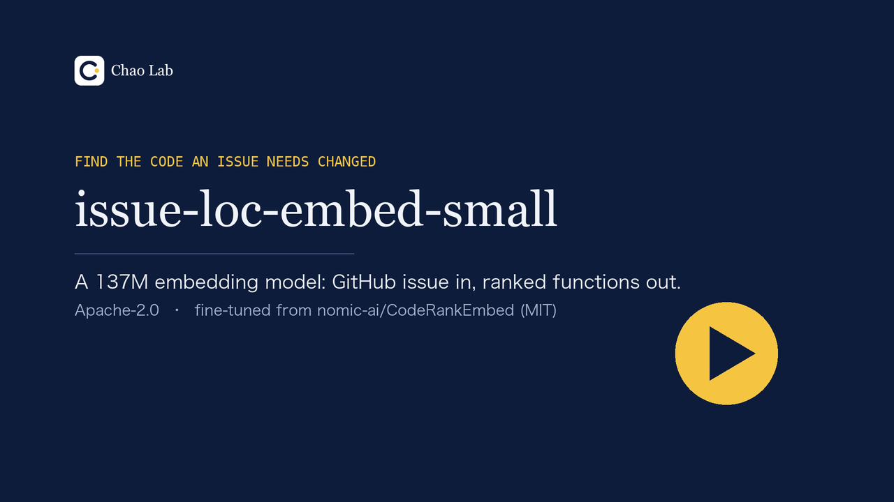

# issue-loc-embed

A small (137M) code embedding model that finds the functions a GitHub issue needs changed, trained with an
**independent, permissively licensed re-implementation** of the SweRank data recipe
([Reddy et al., arXiv 2505.07849](https://arxiv.org/abs/2505.07849)).

SweRank's own models and code are CC-BY-NC-4.0 and its training data is not released. This repository
rebuilds the recipe from the paper text only, on permissively licensed repositories, starting from the MIT
model [`nomic-ai/CodeRankEmbed`](https://huggingface.co/nomic-ai/CodeRankEmbed). The resulting model is
released under Apache-2.0: [ickma2311/issue-loc-embed-small](https://huggingface.co/ickma2311/issue-loc-embed-small).

> Status: research release (v0.1). Numbers below are **measured by us** unless marked otherwise.

[](https://huggingface.co/ickma2311/issue-loc-embed-small/blob/main/demo/issue-loc-embed-demo.mp4)

Demo video (3 minutes, English narration, English and Chinese captions): [watch on Hugging Face](https://huggingface.co/ickma2311/issue-loc-embed-small/blob/main/demo/issue-loc-embed-demo.mp4).

## Results — function localization

Protocol: SweRank / CoRNStack evaluation. Candidate units are the functions and methods of non-test files at
the issue's base commit, each represented as `path/Class/function` + source; gold = the benchmark's
`edit_functions` (class-level labels mapped to `Class.__init__`); Acc@k = all gold functions in the top k.
Dense models use 1,024-token queries and 512-token units. We first reproduced the paper's numbers for the two
reference models with this protocol, to within 1.5 points.

How each row was run:

- **SWE-Bench-Lite.** issue-loc-embed-small (the released `model.safetensors`) and CodeRankEmbed: loaded with
  sentence-transformers as in Usage, but cast to fp16 (Usage runs in the default float32, which we did not
  evaluate); at Acc@5, @10 and @20 every issue has the same hit / miss as in our earlier vLLM fp16 run. Qwen3, the
  round-1 model and SweRankEmbed-Small: vLLM (Qwen3 bf16, the others fp16). LateOn: PyLate with the model in
  float32 and embeddings stored in fp16 for MaxSim scoring.
- **LocBench.** All three models: sentence-transformers, fp16. Qwen3's Lite (vLLM bf16) and LocBench
  (sentence-transformers fp16) numbers were not cross-checked against each other.

### SWE-Bench-Lite (274 issues)

| Model | Licence | Params | Acc@5 | Acc@10 | Acc@20 | File Acc@1 |
|---|---|---|---|---|---|---|
| BM25 (paper-reported) | — | — | 31.75 | 36.86 | — | — |
| lightonai/LateOn-Code-edge ¹ | Apache-2.0 | 17M | 45.62 | 56.20 | — | 51.09 |
| nomic-ai/CodeRankEmbed (start point) | MIT | 137M | 52.19 | 60.22 | 71.53 | 54.01 |
| lightonai/LateOn-Code ¹ | Apache-2.0 | 149M | 53.65 | 60.95 | — | 53.65 |
| Qwen/Qwen3-Embedding-0.6B | Apache-2.0 | 596M | 55.84 | 65.33 | 75.55 | 52.55 |
| round-1 model (this work; not released) | — | 137M | 63.14 | 70.07 | 78.10 | 64.96 |
| **issue-loc-embed-small (this work)** | Apache-2.0 | 137M | 59.49 | 72.99 | 78.83 | 63.87 |
| Salesforce/SweRankEmbed-Small (reference only) | CC-BY-NC-4.0 | 137M | 62.04 | 74.82 | 81.75 | 63.87 |

¹ LateOn models: 256-token queries (their default) and units truncated to 512 tokens (their default is 2,048),
which may understate them.

Paper-reported for the references (Acc@5 / Acc@10): CodeRankEmbed 51.82 / 58.76, SweRankEmbed-Small
63.14 / 74.45 (SweRank Table 1), Qwen3-Embedding-0.6B 52.55 / 62.77 (SweRank Table 9).

### LocBench (Loc-Bench V1, a second benchmark, not used for tuning)

Headline numbers are on 552 of the 560 issues: the 6 `Qiskit/qiskit` and 2 `sktime/sktime` issues were excluded
before scoring because the training data contains a renamed copy (`Qiskit/qiskit-terra`) or a fork (`aeon-toolkit/aeon`) of
those repositories. See [Evaluation hygiene](#evaluation-hygiene).

| Model | Acc@5 | Acc@10 | Acc@15 | File Acc@5 | File Acc@10 | Acc@10, all 560 |
|---|---|---|---|---|---|---|
| nomic-ai/CodeRankEmbed (start point) | 38.77 | 46.74 | 49.82 | 73.55 | 79.17 | 47.32 |
| Qwen/Qwen3-Embedding-0.6B | 40.04 | 48.37 | 53.99 | 74.82 | 82.61 | 48.93 |
| **issue-loc-embed-small (this work)** | 46.20 | 56.70 | 62.14 | 78.44 | 83.70 | 57.32 |

Paper-reported (all 560, SweRank Table 2, function Acc@10 / Acc@15): CodeRankEmbed 47.86 / 50.89 (we measure
47.32 / 50.36), SweRankEmbed-Small 58.57 / 63.39 (not run by us on LocBench).

### Paired comparisons

Paired bootstrap over issues (10,000 resamples, 95% CI), issue-loc-embed-small minus the other model (the
SweRankEmbed-Small comparison pairs our sentence-transformers outputs with SweRankEmbed-Small's vLLM run):

| Comparison | Acc@5 | Acc@10 | Acc@20 (Lite) / Acc@15 (LocBench) |
|---|---|---|---|
| SWE-Bench-Lite, vs CodeRankEmbed | +7.3 (2.9 to 11.7) | +12.8 (8.4 to 17.2) | +7.3 (4.0 to 11.0) |
| SWE-Bench-Lite, vs SweRankEmbed-Small | −2.6 (−7.3 to +2.2) | −1.8 (−6.2 to +2.2) | −2.9 (−6.2 to 0.0) |
| LocBench (552), vs CodeRankEmbed | +7.4 (4.5 to 10.3) | +10.0 (7.1 to 13.0) | +12.3 (9.4 to 15.2) |
| LocBench (552), vs Qwen3-Embedding-0.6B | +6.2 (2.7 to 9.4) | +8.3 (4.9 to 11.6) | +8.2 (4.7 to 11.4) |

Against SweRankEmbed-Small on SWE-Bench-Lite the Acc@10 difference is −1.82 points (paired 95% CI −6.20 to
+2.19); this experiment does not establish that the two models are equivalent. All intervals cover the sampling of benchmark issues only, not training variance (there
is one training run). In that run, the second mining round scores higher than the first at Acc@10 (+2.9, CI 0.7
to 5.5) and lower at Acc@5 (−3.6, CI −6.6 to −1.1); a single run does not show whether the second round helps.
We report Acc@10 as the main metric. Qwen3-Embedding was queried with the
instruction `Instruct: Given a GitHub issue, retrieve the code that needs to be changed to resolve it\nQuery:`.

Ablation (round 1, same 286 steps, same number of training pairs — 43,068 — drawn without the consistency
filter): 56.57 Acc@10 vs 70.07 with the filter (paired difference +13.5, 95% CI 8.4 to 18.6). The unfiltered
model's point estimate is 3.6 below the start point (CI −9.9 to +2.6, not significant). In this run, training
without the filter gave no gain over the start point — the same direction as SweRank Fig. 5a, whose unfiltered
run used more data (one run per arm).

### Robustness and side effects (measured by us)

From the retained summary outputs of those runs (vLLM); per-query results were not kept.

| Check | CodeRankEmbed | This work | Δ |
|---|---|---|---|
| SWE-Bench-Lite, units as **source code only** (no `path/Class/function` line) — Acc@10 | 50.73 | 55.84 | +5.1 |
| SWE-Bench-Lite, **test files included** in the candidate pool — Acc@10 | 42.70 | 62.04 | +19.3 |
| General code search: MTEB CodeSearchNetRetrieval (Python, 1,000 queries) — nDCG@10 | 95.53 | 94.39 | −1.1 |
| same — Acc@1 | 90.90 | 88.90 | −2.0 |

Most of the gain needs the unit format used in training (path line first). With source code only, the gain
shrinks to about 5 points. General docstring-to-code search gets slightly worse. One training repository
(`apache/airflow`) also appears in the CodeSearchNet corpus.

## Evaluation hygiene

- **One training run, one model family.** The model was trained once (seed 0; a second run with the same seed
  gave the same evaluation metrics). The confidence intervals above come from resampling the benchmark issues
  only; they say nothing about run-to-run training variance or about other base models.
- **No separate validation set.** The evaluation protocol (candidate units, unit text format, gold mapping) was
  fixed by reproducing the SweRank paper's numbers for CodeRankEmbed and SweRankEmbed-Small on SWE-Bench-Lite,
  that is, after looking at Lite results of those reference models (not of our models). The training text
  format was then aligned to the same SweRank / CoRNStack format. Hyper-parameters, step count and the released
  checkpoint (the final step of round 2) were fixed before any of our models was evaluated; no checkpoint or
  seed was selected on a benchmark. LocBench was not used for tuning; its comparison, test and exclusions were
  fixed before scoring.
- **No temporal holdout.** Training and evaluation repositories are disjoint by name, but the issue dates
  overlap: training issues 2014-04-30 to 2025-07-22, SWE-Bench-Lite 2012-09-20 to 2023-07-17, LocBench
  2015-11-07 to 2025-02-07. Several training repositories share an organisation or ecosystem with evaluation
  repositories (for example `dask/distributed` and LocBench's `dask/dask`).
- **What we checked, and the limits.**
  - Repository names (case-insensitive) against all SWE-bench, SWE-bench Lite and LocBench repositories, plus 13
    training repositories dropped for sharing a project name with one. A GitHub API check of fork parents and
    renames of all 3,378 training repositories found that `Qiskit/qiskit-terra` (81 training tasks) is the
    former name of LocBench's `Qiskit/qiskit`. This check cannot find hard (detached) forks, and one evaluation
    repository no longer exists on GitHub.
  - Hard forks found by name: `aeon-toolkit/aeon` (a fork of LocBench's `sktime`, excluded above) and
    `diofant/diofant` (a SymPy fork, 3 training tasks; mapping their positive function ids from `diofant/` to
    `sympy/` gives no match with SWE-Bench-Lite's SymPy gold ids). After scoring we also noticed that LocBench's
    `matchms/matchms-backup` (1 issue) is a copy of the training repository `matchms/matchms`; the headline keeps
    the 552 issues fixed before scoring, and without that issue (551) the difference to CodeRankEmbed is +9.98
    (7.08 to 13.07).
  - Instance ids, base commits and gold function ids (`path:qualname`) do not intersect with training on either
    benchmark. Issue text was compared lexically only (8-word shingles; the largest share of an evaluation issue
    found in one training issue is 0.29 on Lite and 0.39 on LocBench); one training issue links to a LocBench
    pull request (`numpy/numpy#10615`, from an unrelated repository).
  - Function bodies (whitespace-normalised, at least 200 characters): three evaluation gold functions have an
    identical copy in the training candidate pool — SWE-Bench-Lite's Requests `stream_decode_response_unicode`
    (vendored Requests copies), Django's `Q._combine` (a port in another project) and LocBench's Dask
    `_compute_multiplier` (a vendored Dask copy). None was ever a training positive; whether any was picked as a
    hard negative in the actual run is unknown, because the mined training records were not kept. Semantic
    near-duplicates were not checked.
- **Base-model contamination unknown.** We do not know whether CodeRankEmbed's pre-training data (CoRNStack)
  contains the evaluation repositories.

## Usage

The model has the same architecture and tokenizer as CodeRankEmbed (CLS pooling, normalised embeddings).

```python
from sentence_transformers import SentenceTransformer

model = SentenceTransformer("ickma2311/issue-loc-embed-small", trust_remote_code=True)
units = ["pkg/module.py/MyClass/method\nclass MyClass:    def method(self, ...):\n        ...",
         "pkg/util.py/helper\ndef helper(x):\n    ..."]
model.max_seq_length = 1024   # queries, as evaluated
q = model.encode([issue_title_and_body], prompt="Represent this query for searching relevant code: ",
                 normalize_embeddings=True)
model.max_seq_length = 512    # code units, as evaluated
d = model.encode(units, normalize_embeddings=True)
scores = (q @ d.T)[0]
```

Represent each candidate as `<path>/<Class>/<function>` on the first line followed by its source (methods
prefixed with `class <Class>:`), exactly as in training and evaluation; queries need the prefix above. The
configuration's default `max_seq_length` (8192) is CodeRankEmbed's. Evaluated with sentence-transformers 5.7.0
and transformers 4.57.6, cast to fp16 on a GPU
(`model.half()`); the model also loads with transformers 5.16.1.

## Reproduce

All Hugging Face datasets and models are read at the revisions pinned in `issueloc/revisions.py` (the revisions
used for every reported number). Run commands from the repository root.

The pinned extras in `pyproject.toml` are separate environments (their transformers pins conflict); use one
virtual environment per role:

```bash
python -m venv .venv-train && .venv-train/bin/pip install -e ".[fast,test]"   # steps 1-3: vllm 0.31.0, transformers 5.17.0
```

```bash
python -m venv .venv-eval && .venv-eval/bin/pip install -e ".[eval]"         # step 4: sentence-transformers 5.7.0, transformers 4.57.6
```

The LateOn baselines use a third environment (`.[lateon]`: pylate 1.6.0, transformers 5.3.0).

1. **Data** (CPU, about 30 min with 12 workers; needs `git` and network access to GitHub):
   `OUT_DIR=build python build_data.py --workers 12` writes `build/data/` — training tasks from SWE-rebench /
   SWE-rebench-V2 (permissive repositories, evaluation repositories removed), the repositories fetched at each base
   commit, functions split out and patches mapped to modified functions, plus the SWE-Bench-Lite corpus.
2. **Paper protocol**: `python -m issueloc.paperfmt build/data data` converts it to the SweRank / CoRNStack format
   (step 3 runs this itself).
3. **Training and evaluation** (one L4 GPU on Colab, about 6.5 h each). Copy the step-1 output directory
   (`build/data`, i.e. `$OUT_DIR/data`) to `/content/build/data` and start from the repository root; both scripts
   write to `/content/out` (a stage that times out is killed together with the vLLM workers it started):
   - `python colab/train_and_eval.py` — consistency filtering and hard-negative mining with CodeRankEmbed, round-1
     training, re-mining with the round-1 model, round-2 training (again from CodeRankEmbed), the unfiltered
     ablation, and evaluation;
   - `python colab/retrain_release.py` — repeats the two training rounds with the same settings and keeps the
     weights (`M2.pt` is the released model), plus the robustness evaluations.

   Embedding here uses vLLM (checked against the Hugging Face implementation for CodeRankEmbed, SweRankEmbed-Small
   and the fine-tuned model; cosine ≥ 0.9999).
4. **Evaluation of the released file** (two T4 GPUs):
   - `OUT_DIR=locb python build_locbench.py --workers 12` (CPU) builds the LocBench corpus with the same pipeline;
   - `python eval_st.py --set lite --model REL --root <dir with the eval_*_paper files and locb_*_paper files>
     --rel-dir <released model directory>`, likewise `--model B0` and `--set locb` with `REL`, `B0`, `QWEN06`
     (REL = the released model, B0 = CodeRankEmbed, QWEN06 = Qwen3-Embedding-0.6B); results go to
     `$OUT_DIR/st_eval_<set>_<model>.json`. Input files are checked against the SHA-256 values of our evaluation files (`--no-input-check` for a rebuilt
     corpus);
   - `python compare_st.py --dir <those results> --orig <results of step 3>` computes the tables and paired
     intervals.
5. **Data checks**: `scripts/checks/` (fork / rename check of the training repositories via `gh api`, overlap with
   LocBench, pinned dataset revisions).

Training: InfoNCE over all in-batch positives and 15 mined hard negatives per (issue, positive function) pair,
batch 64, lr 2e-5, temperature 0.05, fp16 with GradCache, 286 steps per round (about 43% of an epoch over the
43,068 filtered pairs; SweRank trains two epochs). Consistency filter: keep a pair if its positive ranks within
the top K of a file-level sample of the repository (about 300 functions per snapshot), K = 20 scaled by sample
size / estimated repository size; hard negatives are mined from the same sample. Re-running the filtering step
with the Hugging Face encoder on T4 keeps 43,074 pairs (vLLM on L4: 43,068), probably from numerical
differences near the cut-off (the original list was not kept, so this was not checked pair by pair).

## Licensing

- Code in this repository: Apache-2.0 (see LICENSE and NOTICE; `third_party/cornstack` is Apache-2.0 code
  from CoRNStack, itself derived from MIT-licensed Agentless).
- Model weights: Apache-2.0, fine-tuned from the MIT-licensed CodeRankEmbed.
- Training data: code and issue text are not redistributed; see [docs/DATA.md](docs/DATA.md). The pointer
  file `data/train_pointers.parquet` (instance ids, repositories, commits, derived function ids) is adapted from
  `nebius/SWE-rebench` and `nebius/SWE-rebench-V2` (Nebius, CC-BY-4.0,
  https://creativecommons.org/licenses/by/4.0/; changes: row selection and derived function ids) and is
  distributed under CC-BY-4.0.
- Evaluation data (SWE-bench Lite, LocAgent's labels, Loc-Bench V1) is used for evaluation only; see NOTICE.
- SweRank code and weights (CC-BY-NC-4.0) were not used for training, filtering or mining;
  SweRankEmbed-Small was only evaluated as a reference.

## Limitations

- Trained on Python repositories only; evaluated on SWE-Bench-Lite and LocBench (Python).
- The gain depends on the unit format: +12.8 Acc@10 on SWE-Bench-Lite with the `path/Class/function` line, +5.1
  with source code only. Use the format shown in Usage.
- Slightly worse than the start point on general docstring-to-code search (CodeSearchNet Python nDCG@10
  −1.1); if your tool mainly serves short natural-language code queries, keep CodeRankEmbed for those.
- Trained for 286 steps per round (about 43% of an epoch), once; SweRank trains two epochs.
- About 22% of the positive labels (before filtering) are class-level labels mapped to `Class.__init__`; these are
  noisy.

## Citation

Please cite SweRank (the method), CoRNStack (the evaluation protocol and the base model's training data),
SWE-rebench (the training data source) and LocAgent (the evaluation labels and LocBench):

- Reddy et al. SweRank: Software Issue Localization with Code Ranking. arXiv 2505.07849.
- Suresh et al. CoRNStack: High-Quality Contrastive Data for Better Code Retrieval and Reranking. arXiv 2412.01007.
- Badertdinov et al. SWE-rebench: An Automated Pipeline for Task Collection and Decontaminated Evaluation of
  Software Engineering Agents. arXiv 2505.20411. SWE-rebench V2: Language-Agnostic SWE Task Collection at Scale.
  arXiv 2602.23866.
- Chen et al. LocAgent: Graph-Guided LLM Agents for Code Localization. arXiv 2503.09089.
